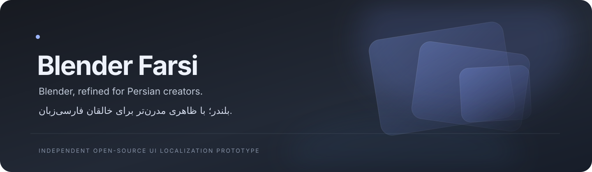

<div align="center">
  
  <h1>Blender Farsi</h1>
  <p><strong>Blender, refined for Persian creators.</strong><br>
  <sub>بلندر؛ با ظاهری مدرن‌تر برای خالقان فارسی‌زبان.</sub></p>
  <p>A source-level localization and visual-refinement project for Blender.<br>
  Independent community work — not an official Blender Foundation product.</p>
  <p>
    <a href="https://github.com/ManiPeak/Blender_Fa"></a>
    
    
    
  </p>
</div>

> **Prototype status.** This repository currently contains a reviewable native top-bar language-selector patch, design/localization specifications, and static validation. A modified Blender executable has **not** been built or tested yet. No application screenshots or downloadable release are available; the banner above is project branding, not an application screenshot.

## Project at a glance

| Area | Current status | Evidence / next step |
| --- | --- | --- |
| Native Language menu | **Prototype patch** | `patches/0001-topbar-language-selector.patch`; not yet applied to a built Blender |
| Persian and English switching | **Implemented in patch; runtime unverified** | Uses Blender's `fa_IR` and `en_US` preference values; save/restart behavior still needs Blender testing |
| Persian UI translations | **Upstream foundation exists** | Blender 4.5.9 includes `locale/po/fa.po`; coverage is incomplete upstream and is not represented as complete here |
| Visual refinement | **Design specification** | `docs/design-system.md`; native theme work and visual comparison remain |
| Original layout preservation | **Source-level intent** | Adds one menu entry to the existing top-bar menu sequence; visual/workspace regression testing remains |
| Windows x64 package | **Workflow configured; build unverified** | `.github/workflows/windows-build.yml` targets Windows 2022; no successful application build/package yet |
| Automated validation | **Static checks** | `python3 -m unittest discover -s tests -v`; not a Blender integration suite |
| GitHub Release | **Not available** | No built or verified package exists, so no release is published |

## What is being built

Blender Farsi aims to keep Blender's editors, workspaces, shortcuts, APIs, and established spatial workflows intact while making Persian localization easier to reach and defining a calmer, more carefully tuned native visual language. Any visual changes must remain within Blender's theme/UI architecture: no replacement interface, permanent dashboard, or global RTL mirroring.

### Native language menu

The prototype patch adds **Language / زبان** to the existing application-menu row and provides **فارسی** and **English** choices. It writes Blender's existing language preference (`fa_IR` or `en_US`) and requests a user-preferences save; it does not touch the current `.blend` document. Blender already ships a Persian gettext catalog in the selected upstream revision. Translation completeness, text shaping, persistence, and refresh behavior still require testing in the actual executable.

### Persian localization

Persian is not the same thing as a right-to-left UI layout. The project uses Blender's gettext pipeline and existing Persian catalog rather than introducing a competing translation framework. Technical controls, node graphs, shortcuts, paths, and numeric input should retain their conventional orientation unless a specific tested improvement justifies otherwise. See [`docs/localization.md`](docs/localization.md) and the starter [`docs/terminology/fa-glossary.csv`](docs/terminology/fa-glossary.csv).

### Visual direction

A restrained dark theme direction is specified in [`docs/design-system.md`](docs/design-system.md). It uses semantic color tokens and Blender-native theme controls as a design target; it is **not yet an applied or tested Blender theme**. Translucent effects and blur are intentionally excluded unless Blender's supported rendering architecture can deliver them without harming clarity or responsiveness.

### Layout and comparison

No original-versus-modified comparison is shown because the modified application has not been built. The patch only inserts one menu entry after the existing top-level menus in `TOPBAR_MT_editor_menus`; no editor regions or workspace geometry are changed by the patch. A real screenshot-based layout comparison is a release prerequisite.

## Get started with the source prototype

The pinned source baseline is Blender `v4.5.9` at commit [`8bf95cbd38d1456c94e9d751f3804eea4d5b137b`](https://github.com/blender/blender/commit/8bf95cbd38d1456c94e9d751f3804eea4d5b137b). This project repository contains the patch, not a vendored copy of Blender's full source history.

```bash
git clone https://github.com/ManiPeak/Blender_Fa.git
cd Blender_Fa
python3 -m unittest discover -s tests -v
```

To prepare a source checkout and apply the prototype patch (requires Git and access to GitHub):

```bash
git clone --filter=blob:none --no-checkout https://github.com/blender/blender.git ../blender-upstream
git -C ../blender-upstream checkout --detach 8bf95cbd38d1456c94e9d751f3804eea4d5b137b
git -C ../blender-upstream apply --check "$PWD/patches/0001-topbar-language-selector.patch"
```

After the check, apply it with `scripts/apply_patch.sh ../blender-upstream` from this project root. The helper refuses a source checkout at any commit other than the pin. Build requirements and Windows build limitations are documented in [`docs/building.md`](docs/building.md). The standard Blender build also needs its platform-specific dependencies and dependency checkout; those have not been provisioned in this workspace.

## Development map

```text
.
├── docs/                 Architecture, design, localization, build, QA and release notes
│   ├── assets/           Project identity artwork (not application screenshots)
│   └── terminology/      Persian glossary starter
├── patches/              Reviewable changes against the pinned Blender revision
├── scripts/              Patch application and validation helpers
├── tests/                Repository-level static validation
└── upstream.lock         Exact upstream tag, commit and source paths
```

### Validate the prototype

```bash
python3 -m unittest discover -s tests -v
python3 scripts/validate_patch.py
```

These checks validate the patch format, pinned baseline references, and project-owned text/code invariants. They do **not** compile Blender, launch its UI, validate gettext rendering, or establish Windows compatibility.

## Roadmap

- [x] Inspect the Blender 4.5.9 top-bar menu and Persian locale metadata.
- [x] Pin an exact upstream commit and document a native menu patch prototype.
- [x] Define layout-preservation criteria and a Figma-ready design specification.
- [ ] Apply and review the patch against a complete upstream checkout.
- [ ] Build and run Blender on a supported developer host; verify switching, persistence, RTL, and core workflows.
- [ ] Implement and test native theme refinements with original-layout screenshot comparisons.
- [ ] Expand and review Persian terminology using Blender's translation workflow.
- [x] Configure a Windows x64 CI build, smoke-test, package, and prerelease workflow.
- [ ] Successfully run and verify the actual Windows x64 build and package.
- [ ] Publish an alpha release only after the Windows build and package checks pass.

## Credits and license

Blender is developed by the [Blender Foundation](https://www.blender.org/) and its community. This independent project is based on the [Blender source repository](https://github.com/blender/blender), whose source is generally distributed under **GNU GPL version 2 or later**; see the upstream [`COPYING`](https://github.com/blender/blender/blob/v4.5.9/COPYING) file and each file's notices. The Persian catalog referenced here is maintained upstream by the Blender translation community; this repository does not claim authorship of it.

Project-specific prototype code and patches are offered under GPL-2.0-or-later. The project identity artwork is original to this repository. This project is not affiliated with or endorsed by the Blender Foundation. See [`LICENSE`](LICENSE) and [`NOTICE.md`](NOTICE.md).

---

<sub>Accurate status over polished promises: the source patch is a prototype until the modified native application is built and tested.</sub>
